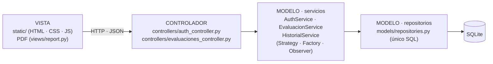

# CardioPrev

Aplicación web que estima de forma orientativa el riesgo cardiovascular de una persona a partir de sus
datos personales, hábitos y valores clínicos, y entrega semáforo de riesgo, recomendaciones, estimación
nutricional, historial por usuario y reporte en PDF.

- Backend: Python + FastAPI · SQLite · JWT · ReportLab
- Frontend: HTML + CSS + JavaScript (responsivo)
- Arquitectura: **MVC** (el Modelo se organiza internamente en servicios y repositorios)
- Patrones de diseño: **Strategy**, **Factory Method** y **Observer**

Instrucciones completas de armado, ejecución, demo y sustentación: ver **GUIA.md**.

```bash
python -m venv .venv && source .venv/bin/activate     # en Windows: .venv\Scripts\Activate.ps1
pip install -r requirements-dev.txt
uvicorn app.main:app --reload                          # http://127.0.0.1:8000
python -m pytest
```

## Arquitectura (MVC)

| MVC | Dónde está | Responsabilidad |
|---|---|---|
| **Vista** | `static/` (HTML, CSS, JS) y `app/views/` (`report.py`, el PDF) | Mostrar datos y recoger lo que escribe el usuario. No tiene reglas de negocio. |
| **Controlador** | `app/controllers/` (`auth_controller.py`, `evaluaciones_controller.py`) | Recibe la petición HTTP, llama a un servicio y devuelve JSON o PDF. Sin SQL ni reglas. |
| **Modelo** | `app/models/`: `models.py`, `services.py` (con `strategies.py`, `factory.py`, `observers.py`), `repositories.py`, `database.py`, `nutrition.py`, `presion.py`, `security.py` | Datos, reglas de negocio, patrones de diseño y persistencia. |



Regla de oro: el controlador **solo habla con servicios**, nunca con repositorios. La prueba
`tests/test_historial.py::TestSeparacionMVC` lo verifica automáticamente.

## Documentación de código

```bash
python generar_docs.py        # backend (pydoc): docs/api/python/app.html
cd front && npm run docs      # front (JSDoc con TypeDoc): docs/api/front/index.html
```

TypeDoc lee los comentarios JSDoc de `front/src` y corre con TypeScript 6 mediante `npx`, porque aún no es
compatible con el TypeScript 7 del proyecto. La salida es generada: `docs/api/` no se versiona.

> CardioPrev no reemplaza el diagnóstico ni la consulta con un profesional de la salud.
